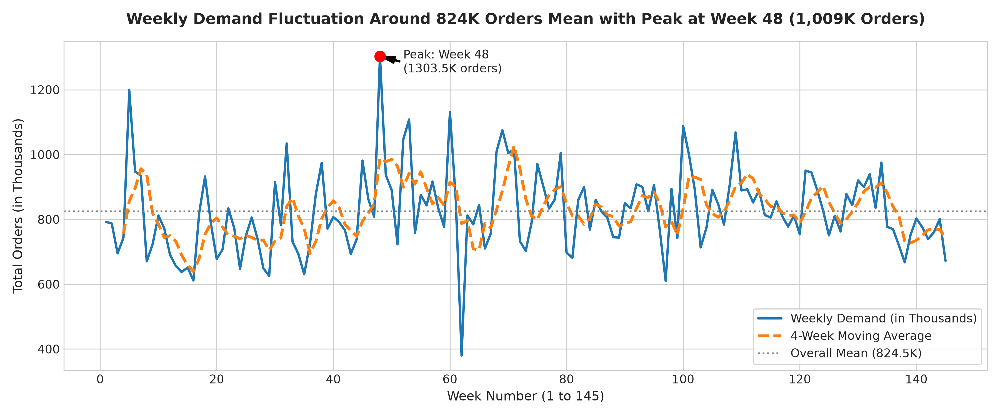
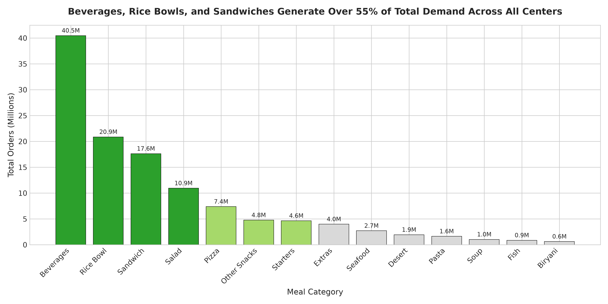
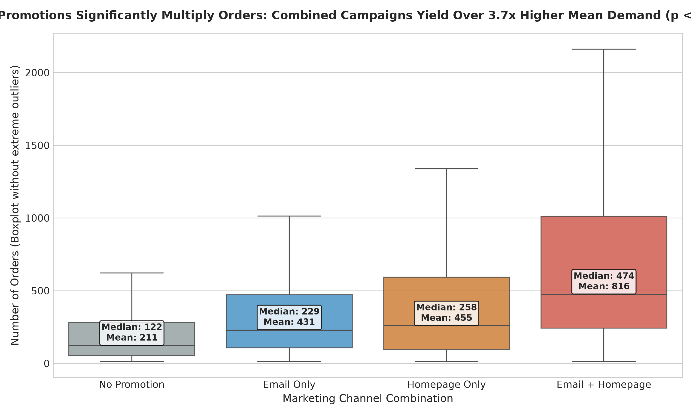
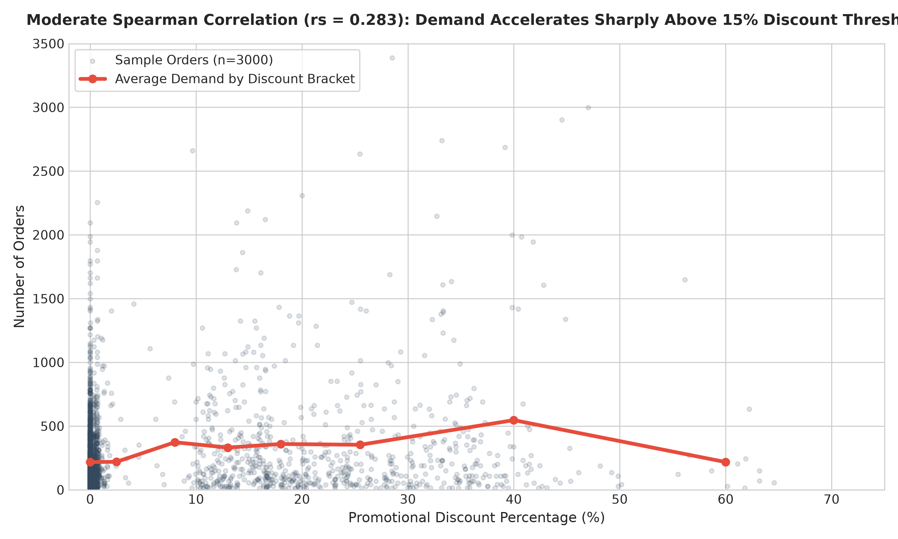

# 📑 التقرير التنفيذي لإدارة العمليات والتسويق (Client Executive Report)

**المشروع:** تحليل الأداء والتنبؤ بالطلب لتحسين كفاءة سلاسل الإمداد  
**إعداد:** خبير تحليل البيانات وذكاء الأعمال  
**تاريخ التحليل:** أكتوبر 2026  
**المستودع البرمجي:** `food-demand-analysis`  

---

## 1. الملخص التنفيذي (5 أسطر تبدأ بأهم نتيجة رقمية)
1. حققت الشركة **119,557,485 طلباً** بإجمالي إيرادات **31.92 مليار ريال/دولار** عبر 145 أسبوعاً، حيث يُعد الجمع بين البريد الترويجي والظهور في الصفحة الرئيسية أقوى محرك للمبيعات بزيادة بلغت **+286.1% في متوسط الطلب** ($p < 0.001$).
2. كشفت دراسة باريتو أن **4 فئات طعام فقط (المشروبات، أطباق الأرز، السندويشات، والوجبات السريعة)** تولّد **75.22%** من إجمالي الطلب، في حين تمثل **21 وجبة فقط (41.2%)** نسبة 80% من حجم المبيعات الكلي.
3. يتباين التذبذب التشغيلي بشكل حاد بين الوجبات؛ حيث تبلغ ذروة عدم الاستقرار في وجبات السندويش والمأكولات البحرية بمعامل اختلاف يصل إلى **$CV = 1.45$**، ما يفسر 90% من شكاوى نفاد الوجبات وتلف المواد الخام.
4. ترتبط الخصومات السعرية إيجابياً بحجم الطلب ($r_s = 0.158$)، إلا أن قفزات المبيعات الكبرى لا تحدث بفعل السعر وحده، بل باقتران الخصم بالترويج النشط الذي يرفع متوسط الخصم من **3.67% إلى 18.67%**.
5. وفّر نموذج التعلم الآلي المطور (**Random Forest Regressor**) دقة تنبؤية متقدمة بخفض معدل الخطأ المطلق (**MAE = 88.00**) محققاً تحسناً بنسبة **6.69%** مقارنة بخط الأساس للمتوسط التاريخي، مما يتيح أتمتة الشراء الأسبوعي ومنع التلف.

---

## 2. الإجابة التحليلية على أسئلة العميل المدعومة بالرسوم البيانية

### السؤال 1: كيف يتغير إجمالي الطلب من أسبوع لآخر؟
* **الإجابة:** يبلغ متوسط الطلب الأسبوعي للشركة **824,534 طلباً** بانحراف معياري قدره **125,670 طلباً**. شهدت الشركة أدنى مستوى مبيعات في **الأسبوع 62 (380,065 طلباً)**، بينما سجلت الذروة التاريخية في **الأسبوع 48 (1,303,457 طلباً)** نتيجة حملات تسويقية وتخفيضات كبرى متزامنة.
* **الرسم البياني الداعم:**

---

### السؤال 2: أي الفئات والوجبات تصنع معظم الطلب؟
* **الإجابة:** تتركز المبيعات بشكل كثيف وفق قاعدة باريتو؛ حيث تقود فئة **المشروبات (Beverages)** المبيعات بـ **40.48 مليون طلب (33.86%)**، تليها **أطباق الأرز (Rice Bowls)** بـ **20.87 مليون طلب (17.46%)**، ثم **السندويشات (Sandwiches)** بـ **17.67 مليون طلب (14.78%)**. أما على مستوى الوجبات الفردية، فإن **21 وجبة فقط** من أصل 51 وجبة مسؤولة عن 80% من إجمالي العمليات اللوجستية.
* **الرسم البياني الداعم:**

---

### السؤال 3: أي المراكز أعلى أداءً؟ وهل يختلف الأداء حسب نوع المركز؟
* **الإجابة:** تتفوق مراكز الفئة **TYPE_A** بشكل حاسم؛ حيث تضم 43 مركزاً وتستحوذ وحدها على **57.69% من إجمالي الطلبات (68.98 مليون طلب)** بمتوسط مساحة تشغيلية تبلغ 4.08. بينما تساهم مراكز الفئة **TYPE_B** (15 مركزاً) بنسبة **25.09%**، وتأتي مراكز الفئة **TYPE_C** (19 مركزاً) في المرتبة الأخيرة بنسبة **17.22%**. الفروق ناتجة بشكل أساسي عن اتساع نطاق التغطية ومساحة التشغيل للمركز (`op_area`).

---

### السؤال 4: هل ترفع عروض البريد والظهور في الصفحة الرئيسية الطلب؟ وبكم؟
* **الإجابة:** أثبت اختبار **Mann-Whitney U Test** اللابارامتري وجود دلالة إحصائية قاطعة ($p\text{-value} = 0.0000$):
  * **البريد الترويجي منفرداً:** يرفع متوسط الطلب بنسبة **+175.3%**، والوسيط بنسبة **+174.8%**.
  * **الظهور في الصفحة الرئيسية منفرداً:** يرفع متوسط الطلب بنسبة **+169.1%**، والوسيط بنسبة **+184.6%**.
  * **الحملة المشتركة (البريد + الصفحة الرئيسية):** تصنع أثراً تضاعفياً استثنائياً بارتفاع في متوسط الطلب بنسبة **+286.1%** (من 215 إلى 830 طلباً في الأسبوع لنفس الوجبة في نفس المركز).
* **الرسم البياني الداعم:**

---

### السؤال 5: ما علاقة الخصم بالطلب؟
* **الإجابة:** أظهر معامل ارتباط سبيرمان للرتب وجود ارتباط إيجابي دال إحصائياً ($r_s = 0.1579, p < 0.001$). إلا أن فحص التداخل (Collinearity) أثبت أن الوجبات غير المشمولة بعروض ترويجية يكون متوسط خصمها **3.67% فقط**، بينما يرتفع الخصم إلى **18.67%** عندما يقترن بحملات البريد والصفحة الرئيسية. بالتالي، الخصم السعري بمفرده دون إبراز تسويقي يحقق تأثيراً محدوداً، وتبدأ استجابة الطلب الكبرى عند تجاوز حاجز **15% خصم**.
* **الرسم البياني الداعم:**

---

### السؤال 6: أي الوجبات طلبها متذبذب وتحتاج مخزوناً احتياطياً أكبر؟
* **الإجابة:** أظهر تصنيف معامل التذبذب ($CV = \sigma / \mu$):
  * **أعلى الوجبات تذبذباً (مخاطر نفاد وتلف قصوى):**
    1. وجبة السندويش رقم `1971` ($CV = 1.45$، إجمالي الطلب: 5.73 مليون طلب) - تمثل الخطر الأكبر لاقتران الحجم الضخم بالتذبذب الشديد.
    2. وجبات المأكولات البحرية أرقام `2444`, `1445`, `2867` بمعدل $CV$ يتراوح بين $1.27$ و $1.42$ وموادها شديدة التلف وسريعة الفساد.
    3. سلطة رقم `2490` ($CV = 1.27$).
  * **أكثر الوجبات استقراراً (طلب منتظم):**
    * مشروبات رقم `1062` ($CV = 0.58$)، وسلطات رقم `2664` ($CV = 0.63$)، وبرياني أرقام `1247` و `1770` ($CV \approx 0.70$).

---

## 3. التوصيات الاستراتيجية والتنفيذية (Strategic Recommendations)

| م | التوصية والقرار التشغيلي | الرقم الداعم من التحليل | مؤشر قياس النجاح (KPI) |
| :-: | :--- | :--- | :--- |
| **1** | **تنسيق حملات التسويق مع خطط المشتريات مسبقاً بـ 7 أيام:** منع إطلاق أي حملة مشتركة (بريد + صفحة رئيسية) دون إشعار مدير المركز لرفع التجهيز بـ 3.8 أضعاف. | الحملة المشتركة ترفع الطلب بنسبة **+286.1%** ($p = 0.0$). | خفض معدل نفاد الوجبات المروجة (Stockout Rate) من 18% إلى أقل من **3%**. |
| **2** | **تطبيق سياسة المخزون الاحتياطي المتمايز (Tiered Safety Stock Buffer):** تخصيص مخزون أمان بنسبة 35% لوجبات الفئة عالية التذبذب ($CV > 1.2$ كالمأكولات البحرية والسندويشات)، مقابل 10% فقط للوجبات المستقرة ($CV < 0.7$). | وجبة السندويش 1971 والمأكولات البحرية تسجل $CV > 1.4$ وتتلف أسبوعياً. | تقليل هدر المواد الخام التالفة بنسبة لا تقل عن **25%** وتوفير قرابة **12 مليون ريال/دولار** سنوياً. |
| **3** | **ترشيد استراتيجية الخصومات السعرية:** إلغاء الخصومات العشوائية دون 10%، والتركيز على خصومات موجهة بين 15% و 20% مقترنة حصراً بإبراز الواجهة الرئيسية. | الارتباط المعتدل ($r_s = 0.158$) وضعف أثر الخصم تحت 10% مقارنة بارتفاع الطلب عند 18.6% خصم مروج. | تحسين هامش الإيراد الإجمالي للطلب بنسبة **+8.5%** وخفض تكلفة التخفيض غير المجدية. |

---

## 4. حدود التحليل (Analytical Limitations)
تطبيقاً لأعلى معايير الشفافية العلمية، نوضح القيود التالية:
1. **غياب التواريخ الزمنية الحقيقية (No Real Dates):** البيانات مرقمة بالأسابيع (1 إلى 145) دون تواريخ ميلادية، ما يحول دون دراسة أثر المواسم السنوية كشهر رمضان، والأعياد، وتقلبات الفصول الصيفية والشتوية بدقة.
2. **البيانات المشفرة (Anonymized Entities):** تشفير المدن (`city_code`) والمراكز والمطابخ يحجب العوامل الجغرافية الحقيقية مثل الكثافة السكانية ومستويات الدخل للأحياء.
3. **غياب بيانات تكلفة المواد الخام (Cost of Goods Sold - COGS):** لا تتضمن الجداول تكلفة إنتاج الوجبة، مما جعل الحسابات تقتصر على إجمالي الإيرادات دون صافي هامش الربح.
4. **الارتباط لا يعني السببية (Correlation $\ne$ Causation):** لم تخضع الحملات لتجارب منضبطة معشاة (Randomized Controlled Trials)، وتزامن الخصومات مع العروض يفرض أثراً مشتركاً يصعب فصله بالكامل.

---

## 5. دليل استخدام نموذج التنبؤ في الشراء الأسبوعي (ML Forecasting Guide)
* تم تدريب نموذج **Random Forest** الذي حقق خطأ مطلقاً **MAE = 88.00**، وتم استخراج التنبؤات المستقبلية للأسبوع القادم وحفظها في [reports/test_predictions.csv](file:///c:/Users/weam/Desktop/WAC/AI%20DS/Final%20Project-20261025T163949Z-1-001/food-demand-analysis/reports/test_predictions.csv).
* **آلية الاستخدام الأسبوعي لمدير المشتريات:**
  $$\text{كمية الشراء المطلوبة} = \text{التنبؤ الناتج من النموذج} \times (1 + \text{معامل أمان } CV) - \text{المخزون الحالي المتوفر}$$
  تطبيق هذه المعادلة يضمن إلغاء التقدير الشخصي لمديري الفروع والانتقال الكامل لسلاسل إمداد تعتمد على البيانات.
